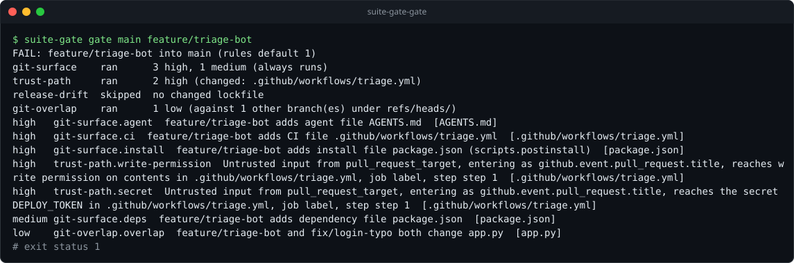
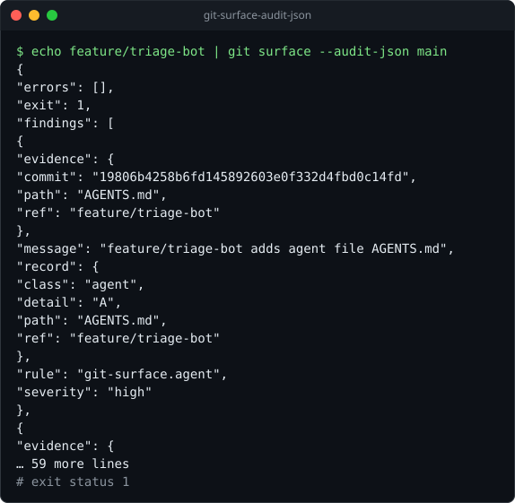

# suite-gate

suite-gate connects six command-line audit tools: git-surface, trust-path, release-drift,
git-overlap, pr-merge-audit and glassbox. It has three parts:

- **One result format.** Each tool, run with `--audit-json`, prints the same JSON object: every
  finding with a rule id, a severity, one sentence and the evidence to check it (file, line, ref,
  commit).
- **A gate.** `suite-gate gate BASE REF` runs the tools that apply to what a branch changes and
  gives one verdict, `pass`, `warn`, `fail` or `error`, from a versioned rules file.
- **An MCP server.** `suite-gate mcp` lets a coding agent run the installed tools and read their
  results, so it can check its own branch before asking for review.

Branches written by coding agents arrive faster than a person can read them. The checks that
matter (does it change CI, an install script, a dependency, a workflow's trust boundary, another
branch's files?) are spread over six tools with six output formats. suite-gate makes them one
check with one answer, and keeps every finding that led to it.

It decides nothing on its own. The verdict follows fixed rules in a file you can read and
version, no model takes part, and each finding is the tool's own, unchanged.

## Example output

The gate on a demo branch that adds a pull-request workflow, an agent instruction file and an
npm install script, and edits a file another branch also edits:

<p align="center"></p>

One tool's result in the shared format (`git surface --audit-json`, first lines):

<p align="center"></p>

## Requirements

- Python 3.9 or later, standard library only.
- git 2.38 or later, as an executable named `git` on `PATH`, for the gate.
- The audit tools to run, at a version that has `--audit-json`:

  | Tool | Minimum | Install |
  | --- | --- | --- |
  | git-surface | 0.4.0 | `pip install git-surface` |
  | trust-path | 0.8.1 | `pip install trust-path` |
  | release-drift | 0.7.0 | `pip install release-drift` |
  | git-overlap | 0.7.0 | `pip install git-overlap` |
  | pr-merge-audit | 2.3.0 | `pip install pr-merge-audit` |
  | glassbox | 0.6.0 | `brew install jacob-adm/tap/glassbox`, or a [release](https://github.com/jacob-adm/glassbox/releases) |

  The gate uses the first four. The MCP server offers each tool that is installed.

## Install

From a clone:

```
git clone https://github.com/jacob-adm/suite-gate
cd suite-gate
pip install .
```

pip installs `suite-gate` as a console script. Check the install:

```sh
suite-gate --version
```

```text
suite-gate 0.1.0
```

Without installing, it also runs from a clone as `python3 -m suite_gate`.

## How it works

1. **Find what the branch changes.** The gate takes the merge base of BASE and REF and lists the
   paths REF changes since then, as a pull request's "files changed" does.
2. **Pick the checks.** The rules file names each check and when it runs: git-surface always,
   trust-path when a workflow changed, release-drift for each changed lockfile, git-overlap
   against the other branches. A check that does not apply is listed as skipped, with the reason.
3. **Run each tool with `--audit-json`.** Every result is checked against the format before it is
   used: a tool that is missing, too old, or prints an invalid object is an error, never a pass.
4. **Decide.** `fail` if a finding has a severity the rules fail on (`high` by default); else
   `error` if a check could not run; else `warn` if a finding has a warn severity (`medium`,
   `low`); else `pass`. The exit status is 1 for `fail`, 2 for `error` and 0 otherwise.
5. **Report.** One line per check, then each finding with its path and line. With `--json`, one
   object with the rules' name, version and SHA-256, the commits, and every tool's result,
   unchanged.

## Commands

```
suite-gate gate [--repo DIR] [--rules FILE] [--json] BASE REF   one verdict for REF against BASE
suite-gate mcp [--timeout SECONDS]                              serve the audit tools to an MCP client
suite-gate validate [FILE]                                      check an audit result object
```

See [Gate](https://github.com/jacob-adm/suite-gate/blob/main/docs/gate.md) for every option, the
rules file and the JSON result, and [MCP server](https://github.com/jacob-adm/suite-gate/blob/main/docs/mcp.md)
for the tools an agent gets.

## Quick start

Install the tools the gate runs, then run it inside the repository on the branch to check.
Replace `main` with the base branch:

```sh
pip install git-surface trust-path release-drift git-overlap
suite-gate gate main ci
```

For a branch named `ci` whose only change is to a CI workflow:

```text
FAIL: ci into main (rules default 1)
  git-surface    ran      1 high (always runs)
  trust-path     ran      nothing found (changed: .github/workflows/ci.yml)
  release-drift  skipped  no changed lockfile
  git-overlap    ran      nothing found (against 5 other branch(es) under refs/heads/)
high   git-surface.ci  ci modifies CI file .github/workflows/ci.yml  [.github/workflows/ci.yml]
```

git-surface reports the workflow change as `high`, so the verdict is `fail` and the exit status
is 1. trust-path ran because a workflow changed and found no path from untrusted input. No
lockfile changed, so release-drift was skipped.

To give a coding agent the tools, register the MCP server. For Claude Code:

```sh
claude mcp add suite-gate -- suite-gate mcp
```

## Documentation

- [Gate](https://github.com/jacob-adm/suite-gate/blob/main/docs/gate.md): the command, the rules file, the verdict and the JSON result.
- [MCP server](https://github.com/jacob-adm/suite-gate/blob/main/docs/mcp.md): setting it up, the tools, and how results and errors are returned.
- [Result format](https://github.com/jacob-adm/suite-gate/blob/main/docs/format.md): the object each tool prints with `--audit-json`, its exit status rules, and the
  [JSON Schema](https://github.com/jacob-adm/suite-gate/blob/main/schema/audit-result-1.schema.json) with
  [examples](https://github.com/jacob-adm/suite-gate/tree/main/examples) that pass and fail.
- [Screenshots](https://github.com/jacob-adm/suite-gate/tree/main/docs/screenshots): each tool's real output on a demo repository, with and without
  `--audit-json`.
- [Contributing](https://github.com/jacob-adm/suite-gate/blob/main/CONTRIBUTING.md): running the tests and contributing a change.
- [Reporting a vulnerability](https://github.com/jacob-adm/suite-gate/blob/main/SECURITY.md)

## License

Apache License 2.0; see [LICENSE](https://github.com/jacob-adm/suite-gate/blob/main/LICENSE).
