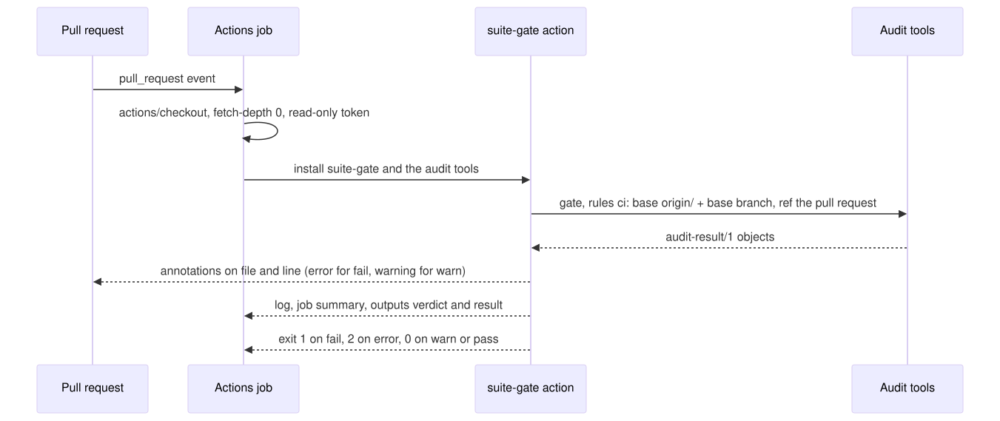

# GitHub Action

The suite-gate action runs the [gate](gate.md) on a pull request: it installs suite-gate and the
audit tools, gives one verdict, annotates each finding on its file and line in the pull request,
and writes a summary of every check to the job's page.

<p align="center"></p>

## Workflow

Copy this file to `.github/workflows/suite-gate.yml`, with `COMMIT` the suite-gate commit to use
(see [Pinning](#pinning)):

```yaml
# One verdict for each pull request from the audit tools: what it changes that runs or is
# trusted, new paths from untrusted input in its workflows, what its lockfile upgrades pull in,
# and which other open branches change the same files.
name: suite-gate
on:
  pull_request:
permissions:
  contents: read
jobs:
  gate:
    runs-on: ubuntu-latest
    steps:
      - uses: actions/checkout@3d3c42e5aac5ba805825da76410c181273ba90b1 # v7.0.1
        with:
          fetch-depth: 0
          persist-credentials: false
      - uses: jacob-adm/suite-gate@COMMIT
```

- `pull_request`, not `pull_request_target`: the job reads the pull request's files and runs no
  code from them, with a read-only token.
- `fetch-depth: 0` fetches every branch, so the gate finds the merge base and the other open
  branches. A shallow checkout is an error, never a pass.
- The check fails (exit 1) on a `high` finding and errors (exit 2) when a check could not run.
  A `warn` passes, with its annotations shown.

## Inputs

| Input | Default | Meaning |
| --- | --- | --- |
| `base` | `origin/` and the pull request's base branch | Commit or branch to compare with |
| `ref` | `HEAD` (the pull request merged into its base, as actions/checkout leaves it) | Commit or branch to judge |
| `rules` | `ci` | A rules file in the repository, or a built-in name: `ci` (other branches under `origin/`) or `default` (under `refs/heads/`). See [Rules](gate.md#rules) |
| `lockfile-cache` | none | A directory release-drift reads packages from instead of PyPI and npm |
| `python-version` | `3.13` | Python the tools run on; set up with actions/setup-python, so later steps of the job see it too |

Each input reaches the gate through an environment variable, never inside a script.

## Outputs

| Output | Value |
| --- | --- |
| `verdict` | `pass`, `warn`, `fail` or `error` |
| `result` | Path of the gate result object (`gate-result/1`) on the runner, for a later step to read or upload |

## What it shows

- **The log** has the gate's text report: the verdict, one line per check, then each finding.
- **Annotations:** each finding with a fail severity is an error on its file and line, and each
  with a warn severity a warning; GitHub shows them in the pull request's "Files changed". A
  release-drift finding is about a file inside a downloaded package, so it is shown on the
  lockfile that pulled the package in. A check that could not
  run is an error annotation naming the tool and the reason.
- **The job summary** has the verdict, the commits and rules, a table of the checks (ran,
  skipped with the reason, or error), and a table of the findings with their evidence.

## Pinning

Use the action by its full commit, as above, not by a branch: a branch can change under you. The
audit tools it installs are pinned in [requirements-tools.txt](../requirements-tools.txt), so a
commit of suite-gate always runs the same tool versions. To move to newer tools, move to a newer
suite-gate commit after reading what changed.

## Tested

The tests run `suite-gate action` as the action's step does, on a clone that looks like a pull
request checkout (every branch under `origin/`, HEAD detached at the pull request), with
`GITHUB_*` set as Actions sets them. They check the verdict, the exit status, the annotations,
the job summary, the outputs, that the pull request's own branch is not counted as an overlap,
a rules file from the repository, and that a shallow checkout is an error.
