# Gate

`suite-gate gate BASE REF` runs the audit tools a rules file names on the changes REF makes
since its merge base with BASE, and gives one verdict: `pass`, `warn`, `fail` or `error`. The
verdict follows fixed rules; no model takes part. Every tool's audit result is kept unchanged,
so each finding keeps its rule, severity, sentence and evidence.

```
suite-gate gate [--repo DIR] [--rules FILE] [--json] [--lockfile-cache DIR] [--timeout SECONDS] BASE REF
```

For the `ci` branch of the test fixture, whose only change is to a CI workflow:

```
FAIL: ci into main (rules default 1)
  git-surface    ran      1 high (always runs)
  trust-path     ran      nothing found (changed: .github/workflows/ci.yml)
  release-drift  skipped  no changed lockfile
  git-overlap    ran      nothing found (against 5 other branch(es) under refs/heads/)
high   git-surface.ci  ci modifies CI file .github/workflows/ci.yml  [.github/workflows/ci.yml]
```

The first line is the verdict. Then one line per check: whether it ran, was skipped or failed
to run, and why. Then each finding above `info`, most severe first, with its path and line.

<p align="center"></p>

The checks and conditions are the built-in rules; a rules file can change them. By default
`high` fails and `medium` and `low` warn.

## Rules

The built-in rules ([suite_gate/rules/default.json](../suite_gate/rules/default.json)):

| Check | When | Runs |
| --- | --- | --- |
| git-surface | always | `git surface --audit-json BASE` on REF |
| trust-path | a changed path matches `^\.github/workflows/` | `trust-path --audit-json --ref REF` |
| release-drift | for each changed lockfile (`package-lock.json`, `npm-shrinkwrap.json`, `uv.lock`, `poetry.lock`, `requirements*.txt`) | `release-drift lockfile --audit-json` on its version at the merge base and at REF; a lockfile added or deleted by REF is skipped, since there is nothing to compare |
| git-overlap | always, if another branch exists under `refs/heads/` | `git footprint BASE` of REF and every other branch there, then `git overlap --audit-json --with REF` |

and the verdict: `high` fails; `medium` and `low` warn.

`--rules FILE` replaces the built-in rules with a file of the same shape:

```json
{
  "format": "gate-rules/1",
  "name": "default",
  "version": 1,
  "checks": [
    {"tool": "git-surface"},
    {"tool": "trust-path", "when_changed": ["^\\.github/workflows/"]},
    {"tool": "release-drift", "for_each_changed": ["(^|/)(package-lock\\.json|...)$"]},
    {"tool": "git-overlap", "others": "refs/heads/"}
  ],
  "verdict": {"fail": ["high"], "warn": ["medium", "low"]}
}
```

- `checks` run in order. `tool` is one of `git-surface`, `trust-path`, `release-drift` and
  `git-overlap`. Patterns are Python regular expressions searched in each changed path.
- trust-path takes an optional `when_changed`; without it, it always runs. release-drift needs
  `for_each_changed`. git-overlap needs `others`, a ref prefix.
- `verdict.fail` and `verdict.warn` are lists of `high`, `medium` and `low`; a severity cannot be
  in both. A severity in neither does not affect the verdict.
- Any other key, or a value of the wrong shape, is refused before anything runs (exit 2).

Change `name` or `version` when you change the rules: both, and the file's SHA-256, are in every
gate result, so a verdict always says which rules gave it.

## Verdict

From the findings of every check, in this order:

| Verdict | When | Exit |
| --- | --- | --- |
| `fail` | a finding has a severity in `verdict.fail` | 1 |
| `error` | otherwise, a check could not run (a tool missing, too old or timed out) or a tool reported an error | 2 |
| `warn` | otherwise, a finding has a severity in `verdict.warn` | 0 |
| `pass` | otherwise | 0 |

A `fail` stands even when another check errored: what was found is certain. An error without
such a finding is `error`, never `pass`, because part of the branch was not checked.

If the gate cannot start (a bad rules file, BASE or REF not a commit, an argument that starts
with `-`), it writes one line to standard error and exits 2 without a result.

## JSON

With `--json` the gate prints one object:

| Key | Value |
| --- | --- |
| `format` | `gate-result/1` |
| `rules` | `name`, `version` and `sha256` of the rules file |
| `base`, `ref` | each `name` as given and the full `commit` it named |
| `merge_base` | the commit the changes are taken from |
| `changed` | the changed paths, sorted |
| `checks` | one object per check run or skipped, in order: `tool`, `status` (`ran`, `skipped` or `error`), `reason`, `path` for a lockfile, `result` (the tool's audit result object, unchanged) or `error` (why it could not run) |
| `verdict`, `exit` | as above |

## Network

release-drift's lockfile check downloads both versions of each upgraded package from its
registry and asks the registry how each was published. `--lockfile-cache DIR` reads packages
from DIR instead (the layout of `release-drift lockfile --cache`) and asks no registry; the
tests use it. The other checks read only the repository.

## MCP

The MCP server's `gate` tool runs the gate with the built-in rules and returns the same object;
see [MCP server](mcp.md).
