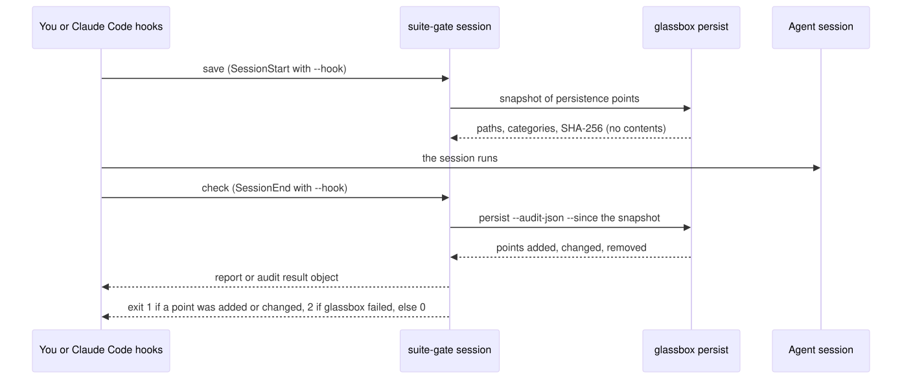

# Session check

`suite-gate session` reports what an agent session left behind that will run again later: a
launch agent, a systemd unit, a cron entry, a changed shell startup file, a git hook, an agent
configuration. It takes a [glassbox](https://github.com/jacob-adm/glassbox) `persist` snapshot
before the session and compares with it afterwards, in the [audit result format](format.md).

```
suite-gate session save  [--state FILE | --hook] [--home DIR] [--repo DIR]...
suite-gate session check [--state FILE | --hook] [--home DIR] [--repo DIR]... [--json]
suite-gate session run   [--state FILE] [--home DIR] [--repo DIR]... [--json] -- COMMAND [ARG]...
```

It needs glassbox 0.6.0 or later on `PATH`.

<p align="center"></p>

`run -- COMMAND` does all three around one command, and exits with the command's own status
when nothing was added or changed.

## Around one command

`run` saves a snapshot, runs COMMAND with its own standard input, output and error, then
compares and writes the report to standard error:

```
$ suite-gate session run --repo . -- my-agent --task fix-tests
...the agent's own output...
suite-gate session: 1 added, 0 changed, 0 removed since /home/me/.local/state/suite-gate/session.snapshot
  Persistence point ~/.zshrc (shell startup) was added since the snapshot
```

The exit status is 1 if a persistence point was added or changed, 2 if glassbox failed, and
otherwise COMMAND's own exit status, so a wrapped command that fails still fails. A removed
point is reported but does not change the exit status. `--json` also prints the audit result
object on standard output, after COMMAND's output.

## Before and after

`save` and `check` are the two halves, for a session that is not one command:

```sh
suite-gate session save --repo .
# ... the agent session ...
suite-gate session check --repo .
```

`check` prints the counts and each point added or changed, or with `--json` the audit result
object, and exits 0, 1 or 2 like the result. A `check` with no snapshot to compare with is an
error (exit 2).

The snapshot is `$XDG_STATE_HOME/suite-gate/session.snapshot` (`~/.local/state/...` when
`XDG_STATE_HOME` is not set), or `--state FILE`. It holds paths, categories and SHA-256 hashes,
never file contents.

## As Claude Code hooks

With `--hook`, `save` and `check` read the JSON that Claude Code gives a hook on standard input
and keep one snapshot per `session_id`, under `$XDG_STATE_HOME/suite-gate/sessions/`, so
sessions running at the same time do not share a snapshot. `check --hook` removes the session's
snapshot once it has compared with it.

In `.claude/settings.json`:

```json
{
  "hooks": {
    "SessionStart": [{"hooks": [{"type": "command",
      "command": "suite-gate session save --hook --repo \"$CLAUDE_PROJECT_DIR\""}]}],
    "SessionEnd": [{"hooks": [{"type": "command",
      "command": "suite-gate session check --hook --repo \"$CLAUDE_PROJECT_DIR\" >> \"$HOME/.local/state/suite-gate/sessions.log\" 2>&1"}]}]
  }
}
```

The SessionEnd command appends each session's report to a log you can read afterwards.

This was run with Claude Code 2.1.332. SessionStart and SessionEnd both received `session_id` on
standard input, and `CLAUDE_PROJECT_DIR` was the project directory. The snapshot was saved when
the session started; when a file was added to the home directory during the session, the
SessionEnd report named it and exited 1.

## What it covers

`--home DIR` audits DIR instead of `$HOME`, and each `--repo DIR` adds that repository's git
hooks, git config and agent configuration files. The locations, and what counts as added,
changed and removed, are glassbox's: see its
[persist](https://github.com/jacob-adm/glassbox/blob/main/docs/commands.md#glassbox-persist)
documentation. Locations outside the home directory (on macOS, login items registered for the
whole machine) can change for reasons that have nothing to do with the session; the report
names each one, so a reader can tell them apart.

glassbox's other session check, `watch`, follows an agent's transcript as it runs. From glassbox
0.7.0, `glassbox watch TRANSCRIPT --once --audit-json` scans a finished transcript for loops,
output spikes and runs of failed tool calls and prints the same result format; this command does
not run it.
